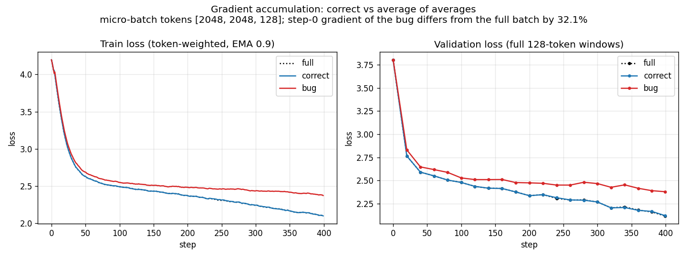
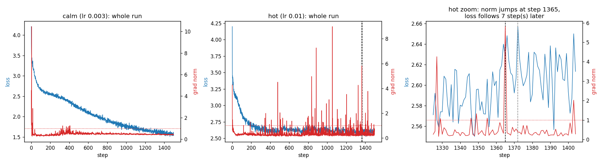

# Training Loop Diagnostics

> Take a small model and a real loop, and make it tell you the truth about itself.

This repository runs six training-loop diagnostics with [Karpathy's nanoGPT](https://github.com/karpathy/nanoGPT) on Tiny Shakespeare (character level). Every number below comes from a script in `src/`, and each script writes its raw numbers to `results/`.

- **Method:** [`PLAN.md`](PLAN.md), written in ASD-STE100 Simplified Technical English.
- **Notebook with all outputs:** [`notebooks/training_loop_diagnostics.ipynb`](notebooks/training_loop_diagnostics.ipynb) &nbsp; [](https://colab.research.google.com/github/jssunil/training-loop-diagnostics/blob/main/notebooks/training_loop_diagnostics.ipynb)

> **Status (15 Oct 2026):** all six parts have results from the final run of the notebook (RTX 5070 Ti). Every number below is copied from `results/*.json`, and the printed output of each part is kept in `results/logs/`.

## How to run

```bash
pip install -r requirements.txt
python -m src.p1_shapes      # part 1
python -m src.p2_gradcheck   # part 2
python -m src.p3_accum_bug   # part 3 -> results/p3_accum_bug.png
python -m src.p4_gradnorm    # part 4 -> results/p4_gradnorm.png
python -m src.p5_mfu         # part 5
python -m src.p6_bits        # part 6
pytest -q                    # checks for parts 2, 3 and 6
python scripts/make_notebook.py
jupyter nbconvert --to notebook --execute --inplace notebooks/training_loop_diagnostics.ipynb
```

Each part writes its numbers to `results/<part>.json` and everything it prints to `results/logs/<part>.log`. The log starts with the time and the environment (GPU, torch, CUDA) and ends with the run time. The full notebook takes about 2 minutes on the RTX 5070 Ti.

The same code runs on Google Colab, an AWS GPU or a CPU-only VPS. See [Run in the cloud](#run-in-the-cloud).

**Sharing the GPU with the display.** By default the scripts keep the GPU busy at most 60 % of the time and use at most 60 % of its memory. They do this by sleeping after each step, so that a desktop on the same GPU stays responsive. All timings (part 5) exclude these rests. Set `GPU_DUTY=1.0 GPU_MEM_FRACTION=1.0` for a dedicated GPU, such as on Colab or AWS. `pytest` always runs on the CPU.

**Hardware for the numbers below:** NVIDIA GeForce RTX 5070 Ti (16 GB), Windows 11, PyTorch 2.7.0 + CUDA 12.8, bf16 autocast. Part 2 runs on the CPU in float64 and float32.

**Model:** nanoGPT `model.py` with three small changes, marked `CHANGED:`. They add a shape trace, all-position logits, and a configurable MFU peak. Dropout is 0, so the forward pass gives the same result each time.

| Config | Layers | Heads | C | T | Parameters | Parts |
|---|---|---|---|---|---|---|
| S | 4 | 4 | 128 | 128 | ~0.8 M | 1–4 |
| shakespeare_char (nanoGPT's own) | 6 | 6 | 384 | 256 | ~10.7 M | 5 |

---

## Part 1: Every tensor shape in one step

`python -m src.p1_shapes`, with B = 4 and T = 16. These are chosen to differ from C = 128, nh = 4 and hs = 32, so that each dimension is easy to see. Model S has L = 4 blocks and **818,048 parameters**.

What each symbol means:

| Symbol | Meaning |
|---|---|
| B | sequences in the batch |
| T | token positions in each sequence (one token = one character) |
| C | channels: the width of the residual stream (n_embd) |
| nh | attention heads; C = nh × hs |
| hs | channels per head |
| V | vocabulary size, 65 characters |

**Forward pass** (attention tensors for block 0; blocks 1–3 are the same):

| Tensor | Shape | What each dimension means |
|---|---|---|
| idx | (4, 16) | B sequences × T token positions; each entry is a character id in [0, V) |
| y (targets) | (4, 16) | B × T: the correct next character for each position (x moved one place right) |
| tok_emb | (4, 16, 128) | B × T × C: one C-number embedding vector for each token |
| pos_emb | (16, 128) | T × C: one vector for each position, added to every sequence (broadcast over B) |
| x0 = tok_emb + pos_emb | (4, 16, 128) | B × T × C: the residual stream that enters block 0 |
| attn.q / attn.k / attn.v | (4, 4, 16, 32) | B × nh × T × hs: the query / key / value of each head, for each position (C = nh × hs) |
| attn.scores (inside SDPA, not stored) | (4, 4, 16, 16) | B × nh × T × T: how much position t (row) looks at position s (column); causal, so s ≤ t |
| attn.y_heads | (4, 4, 16, 32) | B × nh × T × hs: the attention output of each head |
| attn.y_merged | (4, 16, 128) | B × T × C: the nh head outputs put side by side again |
| block[0..3] out | (4, 16, 128) | B × T × C: the residual stream after each block (attention + MLP, each with a residual add) |
| ln_f out | (4, 16, 128) | B × T × C: the residual stream after the last LayerNorm |
| logits | (4, 16, 65) | B × T × V: one score per vocabulary entry, for the next token at each position |
| loss | () | a scalar: the mean cross-entropy over all B × T predictions |

**Backward pass.** Each gradient has the same shape as its weight. One block:

| Parameter | Weight = grad shape | What the dimensions mean |
|---|---|---|
| transformer.wte.weight | (65, 128) | V × C: one vector per character; also the output head (tied) |
| transformer.wpe.weight | (128, 128) | block_size × C: one vector per position 0..127 |
| ln_1 / ln_2 / ln_f weight, bias | (128,) | C: one scale or shift per channel |
| attn.c_attn.weight / bias | (384, 128) / (384,) | 3C × C: q, k and v projections stacked (out × in) |
| attn.c_proj.weight / bias | (128, 128) / (128,) | C × C: merges the heads back into the residual stream |
| mlp.c_fc.weight / bias | (512, 128) / (512,) | 4C × C: MLP expansion |
| mlp.c_proj.weight / bias | (128, 512) / (128,) | C × 4C: MLP contraction |

**Optimizer step.** AdamW keeps `exp_avg` and `exp_avg_sq` for each weight, both with the weight's shape. For example, (65, 128) for `wte`.

The full table for all 4 blocks is in [`results/p1_shapes.json`](results/p1_shapes.json) and [`results/logs/p1_shapes.log`](results/logs/p1_shapes.log).

---

## Part 2: Verify one gradient by hand

**The worked chain first.** With h = w1·x, y = w2·h, loss = (y − t)², and w1 = 3, w2 = 4, x = 2, t = 20:
- autograd gives **dL/dw1 = 64.000000**;
- the central difference gives **64.000000**;
- the one-sided nudge 3.000 → 3.001 gives **64.064**. A one-sided difference has an error of order ε; a central difference has an error of order ε².

**One weight in nanoGPT.** The weight is `transformer.h.0.attn.c_attn.weight[3, 7]`, a query weight in block 0. Each nudge uses the central difference `(L(w+ε) − L(w−ε)) / 2ε`.

| Precision | Weight | autograd | Best nudge (ε) | Relative error |
|---|---|---|---|---|
| float64 | [3, 7] | −1.8764120383e-05 | −1.8764120480e-05 (1e-3) | **5.2e-09** |
| float32 | [3, 7] | −1.8764130800e-05 | −1.9073486328e-05 (1e-1) | 1.6e-02 |
| float32 | [308, 23] (largest gradient) | −3.3171892166e-02 | −3.3164024353e-02 (1e-2) | 2.4e-04 |

**What this shows.**
- In float64 the nudge and `backward()` agree to about 8 significant digits.
- In float32 the same check **fails** for this weight, and the reason is worth understanding. The gradient is only 1.9e-5. A nudge of ε changes a loss of 4.2 by 2·ε·1.9e-5. float32 keeps about 7 digits, so it rounds a loss of 4.2 in steps of about 2.5e-7, and that loss change is lost in the rounding. With ε = 1e-3 the change is 4e-8, smaller than one rounding step, so the measured difference is pure rounding noise.
- For the weight with the largest gradient, float32 agrees to about 3–4 digits, best at ε = 1e-2.
- Smaller ε makes float32 worse, not better: there the rounding error, not the truncation error, controls the result.
- This is why `torch.autograd.gradcheck` works in float64.

Full ε tables: [`results/p2_gradcheck.json`](results/p2_gradcheck.json).

---

## Part 3: Break gradient accumulation on purpose

Each step has three micro-batches of 16 sequences each. They hold **128, 128 and 8** real tokens per sequence, so 2048, 2048 and 128 tokens in total. Padding has the target −1 and adds nothing to the loss. Three runs start from the same weights and see the same micro-batches:

| Run | How each micro-batch's loss goes into the gradient |
|---|---|
| full | All micro-batches in one batch: `sum(token losses) / all tokens` |
| correct | `sum(token losses) / all tokens in the step` (the October 2024 fix in HF Transformers and Unsloth) |
| bug | `mean(token losses) / 3`: the **average of the averages** |



| Check | Result |
|---|---|
| Worked example (4, 4, 2 tokens; losses 2, 2, 5) | correct **2.6000**, average of averages **3.0000**, which is **15.4 %** too high |
| Step-0 gradient, correct vs full batch | relative difference **1.2e-07** (the same, apart from float rounding) |
| Step-0 gradient, bug vs full batch | relative difference **32.1 %**, cosine 0.950 |
| Control: three equal micro-batches | bug vs full **1.0e-07**, so the bug **disappears** |
| Train loss, mean of last 50 of 400 steps | full 2.1230 · correct 2.1230 · **bug 2.3899** |
| Final validation loss | full 2.1186 · correct 2.1227 · **bug 2.3802** (**+0.258**) |

**Why it happens.** The short micro-batch holds 3 % of the tokens, but the bug gives it 33 % of the vote. Its tokens are also the first 8 positions of each sequence, which have the least context and so the highest loss. The bug therefore pushes the model to fit early-context characters at the expense of all the others. The control row shows why the bug hid for years: when micro-batches hold equal token counts, the two formulas are identical.

Raw curves: [`results/p3_accum_bug.json`](results/p3_accum_bug.json).

---

## Part 4: The grad norm moves before the loss

`python -m src.p4_gradnorm`: model S, 1500 steps, clip limit 1.0, with the norm logged **before** clipping (after clipping, the norm can never go above 1.0, so a spike cannot be seen).

**Event rule** (fixed before the run):
1. The norm is more than 3× its median over the previous 50 steps.
2. The loss at that step is still inside its normal band (median + 3 × robust spread).
3. The loss leaves the band within the next 10 steps.



| Run | lr | Seed | Median grad norm | Clip active | Events |
|---|---|---|---|---|---|
| calm | 3e-3 | 5 | 0.468 | 13 of 1500 steps | **none** |
| hot | 1e-2 | 6 | 0.272 | 63 of 1500 steps | **6** |

**The calm run has no event.** Its grad norm never jumped while the loss stayed normal. That is the honest result at the planned learning rate, so I report it instead of loosening the rule. To find events, I then searched learning rates 3e-3 to 4e-2 and seeds 5 and 6 with the same rule, and used lr 1e-2, the lowest rate that gave events.

**Events in the hot run** (step: norm ÷ its median → the loss leaves its band *n* steps later):

| Step | Grad norm | × median | Loss at step (band) | Loss leaves band after | Loss peak |
|---|---|---|---|---|---|
| 422 | 0.852 | 3.6× | 2.632 (2.663) | 9 steps | 2.664 |
| **502** | **2.048** | **8.5×** | **2.603 (2.671)** | **2 steps** | **2.721** |
| 503 | 1.962 | 8.2× | 2.642 (2.667) | 1 step | 2.721 |
| 774 | 1.295 | 5.2× | 2.614 (2.681) | 8 steps | 2.694 |
| 1355 | 1.103 | 3.8× | 2.606 (2.630) | 9 steps | 2.640 |
| 1365 | 5.809 | 18.0× | 2.628 (2.652) | 7 steps | 2.657 |

**The example I use is step 502.** The grad norm jumped to 8.5× its median while the loss (2.603) was still *below* its recent median. Two steps later the loss was out of its band, with a peak of 2.721. The norm gave the warning; the loss had not moved yet. Step 1365 has the largest ratio (18×), but its loss rise is small (peak 2.657, band 2.652).

**A finding about reproducibility.** The hot run is not bit-for-bit reproducible on the GPU. bf16 backward kernels add numbers in a non-fixed order, and at lr 1e-2 the training is close to unstable, so these very small differences grow. Over two runs of the notebook, events 422, 502 and 503 were the same, but the paths separated after about step 500. The later events (774, 1355, 1365 in this run) changed. The calm run gave the same numbers both times. Raw curves: [`results/p4_gradnorm.json`](results/p4_gradnorm.json).

**What this means in practice.** A grad-norm spike is an early warning, a few steps before the loss shows anything. Alert on the norm, not only on the loss, and log the norm before clipping.

---

## Part 5: MFU

`python -m src.p5_mfu`: the shakespeare_char config (6 layers, C = 384, T = 256), B = 64, bf16 autocast, fused AdamW.

**Method.**
- MFU = (6N + 12·L·H·Q·T) × tokens/s ÷ peak FLOP/s (PaLM Appendix B, the same formula as nanoGPT `estimate_mfu`).
- N = 10,672,512 non-embedding parameters, so 6N = 64.0 M FLOPs per token, and attention adds 7.1 M FLOPs per token.
- Timing: 10 warm-up steps, then 50 timed steps between `torch.cuda.synchronize()` calls, with batches built before timing. The rests from the GPU duty limit are not counted.

**Result.**

| Quantity | Value |
|---|---|
| Throughput | **567,840 tokens/s** (28.9 ms per step) |
| Model work | **40.4 TFLOP/s** |
| MFU against the 175.8 TFLOP/s spec peak | **23.0 %** (20.7 % without the attention term) |
| Measured ceiling: one 8192×8192 bf16 matmul | 96.9 TFLOP/s |
| Model work as a fraction of the measured ceiling | **41.7 %** |

**About the peak.** Neither number is from NVIDIA. An aggregator (flopper.io) lists 87.9 TFLOP/s bf16 dense for the RTX 5070 Ti, but one plain matmul on this card already reaches about 96–98 TFLOP/s, so 87.9 cannot be the ceiling. I therefore use the same site's dense 16-bit tensor value, 175.8 TFLOP/s, as the peak, and also report the measured matmul ceiling. The honest summary: **23 % MFU on paper, about 42 % of what this card actually achieves on a large matmul.**

**What costs the distance to 40 %** (from `torch.profiler`, one training step):

| Kernel group | Share of GPU time |
|---|---|
| matmul (GEMM) | 53.5 % |
| layernorm / softmax / GELU / cross-entropy | 16.7 % |
| other elementwise ops and copies | 15.1 % |
| attention (SDPA, memory-efficient kernel) | 9.7 % |
| optimizer (fused AdamW) | 5.0 % |

- **Almost half of the GPU time is not matmul.** About 37 % is memory-bound work (LayerNorm, GELU, residual adds, casts, copies, the AdamW update). These kernels read and write whole tensors and do little arithmetic, so the tensor cores sit idle. This is the largest cost.
- **The matmuls are small.** With C = 384, the GEMMs are too small to keep the tensor cores full, so even the matmul time runs well below the 96.9 TFLOP/s that one large matmul reaches.
- **Launch overhead.** One step has 438 kernel launches, and the GPU is busy 93 % of the wall time, so about 7 % is lost to the CPU side and gaps between kernels.
- **No kernel fusion.** `torch.compile` failed on Windows (`TritonMissing`). On Linux, compile would fuse the elementwise ops into fewer kernels. That is the first thing to try, followed by a larger model or batch, and CUDA graphs to cut launch overhead.

---

## Part 6: 0.1 in fp32, bf16 and fp8 E4M3

`python -m src.p6_bits`. The script checks the hand derivation below against torch's own bit patterns: **all three formats agree** (`torch_agrees: true` in [`results/p6_bits.json`](results/p6_bits.json)).

**By hand.**
- 0.1 = 1.6 × 2⁻⁴.
- In binary, 1.6 = 1.**1001 1001 1001**…, and the pattern never ends, so no binary format holds 0.1 exactly.
- The sign bit is 0.
- Each format keeps a different number of mantissa bits and rounds to nearest (ties to even).

| Format | Bits (sign · exponent · mantissa) | Hex | Stored value | Relative error |
|---|---|---|---|---|
| fp32 (E8M23, bias 127) | `0 01111011 10011001100110011001101` | 0x3DCCCCCD | 0.100000001490116 | 1.5e-08 |
| bf16 (E8M7, bias 127) | `0 01111011 1001101` | 0x3DCD | 0.10009765625 | 9.8e-04 |
| fp8 E4M3 (bias 7) | `0 0011 101` | 0x1D | 0.1015625 | 1.6e-02 |

How each value comes out:
- **Exponent field:** −4 + 127 = 123 = `01111011` for fp32 and bf16; −4 + 7 = 3 = `0011` for E4M3.
- **Rounding:** fp32 and bf16 both round up, because the next dropped bits are `11…`, more than half.
- **E4M3 mantissa:** 0.6 × 8 = 4.8, which rounds up to 5 = `101`.

**Which one I would train in.**
- **Arithmetic:** bf16 matmuls with fp32 accumulation.
- **Stored state:** an fp32 master copy of the weights and fp32 optimizer state (16 bytes per weight).
- **fp8 E4M3:** only for matmul inputs, with per-tensor or per-block scales, on hardware that supports it (Hopper, Blackwell).

The reasons:
- bf16 has the same 8-bit exponent as fp32, so it has the same range. Small late-training gradients do not become zero, and it needs no loss scaling.
- fp16 needs loss scaling: its smallest normal number is 6.1e-5 (Micikevicius et al. 2017).
- Precision matters where errors **build up**. An update smaller than about weight/2⁸ disappears when you add it to a bf16 weight, so the master weights and the optimizer moments stay in fp32. fp8 is never used for them.

---

## Run in the cloud

`src/device.py` picks the device, the dtype and the MFU peak (override it with `PEAK_TFLOPS=<value>`). Every script prints and saves the GPU name.

| Host | GPU | Peak used | Notes |
|---|---|---|---|
| Local | RTX 5070 Ti | 175.8 TFLOP/s dense 16-bit | aggregator value, not confirmed by NVIDIA; see part 5 |
| Colab free | T4 | 65 TFLOP/s fp16 | no bf16 tensor cores, so the code uses fp16 |
| Colab Pro / AWS g6 | L4 | 121 TFLOP/s bf16 | |
| AWS g5 | A10G | ~70 TFLOP/s bf16 | check the data sheet |
| Colab Pro | A100 | 312 TFLOP/s bf16 | nanoGPT default |
| Hostinger VPS | none (CPU) | n/a | parts 1–4 and 6 run; part 5 gives tokens/s only |

**Google Colab**
1. Click the *Open in Colab* badge at the top.
2. Choose Runtime → Change runtime type → GPU.
3. Run all cells. The first cell clones this repository and installs the requirements.
4. Save the notebook with its outputs: File → Save a copy in GitHub.

**AWS EC2**
1. Check that the "Running On-Demand G and VT instances" quota is at least 4 vCPU.
2. Launch `g6.xlarge` (L4) or `g5.xlarge` (A10G) with the *Deep Learning OSS Nvidia Driver AMI GPU PyTorch (Ubuntu)*. Allow SSH from your IP only.
3. Run:
   ```bash
   git clone https://github.com/jssunil/training-loop-diagnostics && cd training-loop-diagnostics
   pip install -r requirements.txt && pytest -q
   python -m src.p5_mfu
   jupyter nbconvert --to notebook --execute --inplace notebooks/training_loop_diagnostics.ipynb
   ```
4. Copy `results/` back with `scp`.
5. **Stop the instance when you are done**, because AWS charges by the hour.

**Hostinger (CPU-only VPS)**
1. Create a virtual environment: `python3 -m venv .venv && . .venv/bin/activate`.
2. Install the CPU build of torch: `pip install torch --index-url https://download.pytorch.org/whl/cpu`.
3. Install the rest: `pip install -r requirements.txt`.
4. Run parts 1–4 and 6. Part 5 reports tokens/s, and MFU shows as n/a.

---

## Limits

- The model is small (0.8 M and 10.7 M parameters), so MFU is far below what a large model reaches on the same GPU.
- The RTX 5070 Ti peak FLOP/s comes from an aggregator, not from NVIDIA. Part 5 adds a measured ceiling for that reason.
- One seed per experiment, and the part 4 hot run is not bit-for-bit reproducible on the GPU (see part 4).
- `torch.compile` was not measured, because Triton is not available on Windows.

## References

1. Course notes on the training loop (the worked examples in parts 2 and 3).
2. Micikevicius et al., *Mixed Precision Training*, 2017, [arXiv:1710.03740](https://arxiv.org/abs/1710.03740).
3. Micikevicius et al., *FP8 Formats for Deep Learning*, 2022, [arXiv:2209.05433](https://arxiv.org/abs/2209.05433).
4. Goyal et al., *Accurate, Large Minibatch SGD*, 2017, [arXiv:1706.02677](https://arxiv.org/abs/1706.02677).
5. Pascanu, Mikolov, Bengio, *On the difficulty of training recurrent neural networks*, 2013, [arXiv:1211.5063](https://arxiv.org/abs/1211.5063).
6. Chowdhery et al., *PaLM*, 2022, [arXiv:2204.02311](https://arxiv.org/abs/2204.02311), Appendix B.
7. Hugging Face, [*Fixing Gradient Accumulation*](https://huggingface.co/blog/gradient_accumulation), Oct 2024; Unsloth, [*Gradient accumulation bug fix*](https://unsloth.ai/blog/gradient), Oct 2024.
8. Karpathy, [nanoGPT](https://github.com/karpathy/nanoGPT) (MIT License): `model.py` is copied into `src/model.py` with the changes marked `CHANGED:`.
